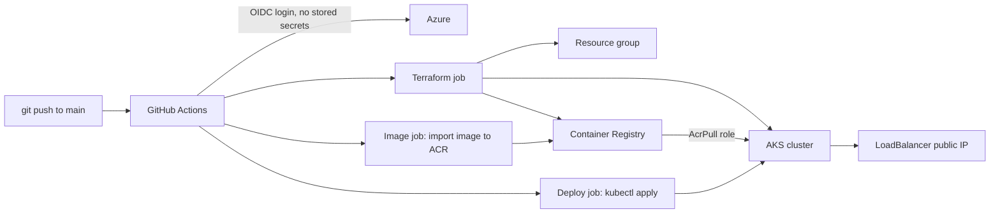

# aks-pipeline: Terraform → Docker → Kubernetes on Azure

A CI/CD pipeline that builds Azure infrastructure with Terraform, places a container image in a private registry, and deploys it to AKS, all from a single `git push`.

## Architecture



## What it does

1. **Terraform job:** creates the resource group, Azure Container Registry and AKS cluster, and grants the cluster's managed identity the `AcrPull` role on the registry. State is stored remotely in Azure Storage.
2. **Image job:** copies the application image into the private registry.
3. **Deploy job:** applies the Kubernetes manifests and waits for the rollout to succeed.

## Key decisions

- **No stored credentials:** GitHub authenticates to Azure with OIDC federation, trusted only for this repo's `main` branch.
- **No registry password:** the registry admin user is disabled, and AKS pulls images using its managed identity.
- **Remote state:** Terraform state lives in an Azure Storage container, so local machines and the pipeline share one source of truth.
- **Jobs are chained:** each job uses the previous job's outputs, so names are never hard-coded across stages.
- **Resource limits and a readiness probe** are set on the pods.

## Repo layout

```
terraform/            Infrastructure as code
k8s/                  Deployment and Service manifests
app/                  Application files
.github/workflows/    Pipeline definition
```

## Cost control

The AKS node is the main cost. Tear everything down with:

```
cd terraform
terraform destroy
```

and rebuild by running the `deploy` workflow from the Actions tab.

## Tech

Terraform, Docker, Kubernetes (AKS), Azure Container Registry, GitHub Actions, OIDC.
